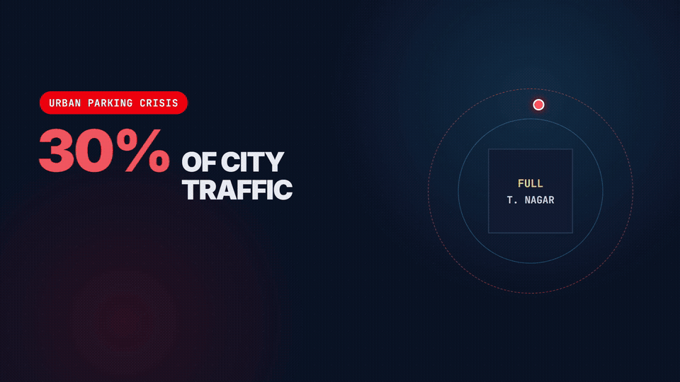

# 🅿️ Parkly — Smart City Decentralized Parking Marketplace

> **"Find, reserve, and navigate to your parking spot before you even turn on your ignition."**  
> Built by **ZEUS Technologies** · Initial Launch Market: **Chennai, Tamil Nadu, India 🇮🇳**

[](https://www.typescriptlang.org/)
[](https://reactnative.dev/)
[](https://aws.amazon.com/)
[](https://www.postgresql.org/)
[](https://www.prisma.io/)

<p align="center">
  
</p>

<p align="center">
  <em><strong>End-to-End Chennai Driver Flow:</strong> Urban Crisis Hook → T. Nagar ETA Prediction → AI Concierge → 3-Tap UPI Checkout → Scannable Entry Gate QR Pass.</em><br />
  👉 <a href="./docs/10_DEMO_GIF_AND_LAUNCH_SHOWCASE.md"><strong>Watch Beat-by-Beat Visual Showcase</strong></a> · 📱 <a href="./docs/09_MOBILE_APP_DEMO_WALKTHROUGH.md"><strong>Android Emulator Screenshot Walkthrough</strong></a> · 🧪 <a href="./docs/11_TESTING_AND_LOCAL_DEV.md"><strong>Local Setup &amp; Tests</strong></a>
</p>

---

## 🌟 Executive Overview

In metro cities like Chennai, **30% of downtown traffic** consists of cars cruising for parking—wasting **20–35 minutes per trip** per driver while 60%–80% of private residential driveways and commercial office bays sit idle.

**Parkly** ("Airbnb for Parking") turns invisible urban bays into guaranteed, reservable digital inventory:
- **Predict Open Bays at Your ETA**: Live availability probability scoring (**88% open**, **72% open**) across high-density Chennai corridors (T. Nagar, Anna Nagar, Adyar, Velachery, OMR).
- **AI Driver Concierge**: Ask naturally (*"Covered spot near Pothys under ₹60/hr"*) and get distance-ranked, rule-verified parking with one-tap **`Instant Reserve`**.
- **The 3-Tap Rule + Zero Hardware Start**: Select bay → confirm Indian registration (`TN01AB1234`) + UPI (`₹126`) → unlock boom barriers with a digital **Entry Gate QR Pass (`#BK-LIVE-1001`)**.
- **Atomic Concurrency Guarantee**: PostgreSQL row-level locking prevents double-bookings under concurrent demand spikes.
- **Full Two-Sided + Municipal Grid**: Automated **80–85% UPI payouts** for property hosts + **8 Autonomous AI Agents** powering KYC onboarding, vision inspection, surge pricing, dispute mediation, and city CO₂ analytics.

---

## 📚 Developer Documentation Suite

| Document | Audience / Coverage |
| :--- | :--- |
| 📘 [**PARKLY MASTER DOCUMENTATION**](./PARKLY_MASTER_DOCUMENTATION.md) | **Single Source of Truth (SSoT)** integrating vision, USP, system design, stack, and implementation status. |
| 🎯 [**01. Project Purpose & Ideology**](./docs/01_PROJECT_PURPOSE_AND_IDEOLOGY.md) | Urban parking crisis telemetry, the 3-Tap Rule ideology, and 3-horizon municipal growth vision. |
| 💡 [**02. USP & Startup Validation**](./docs/02_USP_AND_STARTUP_VALIDATION.md) | Competitive moat, TAM/SAM/SOM market sizing, customer personas, and unit economics. |
| 🏗️ [**03. System Architecture Design**](./docs/03_SYSTEM_ARCHITECTURE.md) | AWS cloud-native topology, microservice boundaries, EventBridge event bus, and dual-DB strategy. |
| 🛠️ [**04. Tech Stack & Tooling**](./docs/04_TECH_STACK_AND_TOOLS.md) | Expo SDK 54 / RN 0.79.1 / React 19.0.0 mobile, React 18/Vite portals, Express microservices, Prisma & AWS CDK. |
| 🗄️ [**05. Database Schema & Data Models**](./docs/05_DATABASE_SCHEMA_AND_MODELS.md) | Full ERD, Prisma models, DynamoDB ephemeral tables, and ACID concurrency locking state machines. |
| 🔌 [**06. Core Services & API Specs**](./docs/06_CORE_SERVICES_AND_API_SPEC.md) | Standardized REST contracts across Auth, Search, Booking, Payments, Host, Occupancy, Pricing, and Admin services. |
| 🚀 [**07. Software Development Roadmap**](./docs/07_SOFTWARE_DEVELOPMENT_PLAN_AND_ROADMAP.md) | Phased go-to-market milestones and Sprint 0–7 engineering deliverables. |
| 🤖 [**08. AI Multi-Agent Architecture**](./docs/08_AI_AGENT_ARCHITECTURE.md) | Specifications for `ParklyOrchestratorAgent` and 7 specialized worker agents. |
| 📱 [**09. Mobile App Demo Walkthrough**](./docs/09_MOBILE_APP_DEMO_WALKTHROUGH.md) | Sequential Android 14 Emulator verification gallery covering Login → Entry Gate QR Pass & AI Concierge. |
| 🎬 [**10. Demo GIF & Launch Showcase**](./docs/10_DEMO_GIF_AND_LAUNCH_SHOWCASE.md) | Scene breakdown, keyframe stills, share copy, and animated media details. |
| 🧪 [**11. Local Development & Testing Guide**](./docs/11_TESTING_AND_LOCAL_DEV.md) | Step-by-step Docker/Prisma setup, API gateway port map (`4000–4011`), and 360-test AI verification suite. |
| 🔐 [**Production Credentials & Deployment**](./PRODUCTION_CREDENTIALS_AND_DEPLOYMENT_GUIDE.md) | Complete production environment keys, Razorpay/AWS setup, and deployment playbook. |
| 🎨 [**Brand & Palette Tokens**](./BRANDING_AND_COLOR_PALETTE.md) | Exact `#0A1425` Navy, `#EF010C` Crimson, `#38BDF8` Cyan tokens & logo deployment. |

---

## 🏗️ Monorepo Layout & Architecture

```
Parkly/
├── apps/
│   ├── mobile/          # 📱 Expo SDK 54 (RN 0.79.1 / React 19.0.0) Driver App (see apps/mobile/README.md)
│   ├── host-dashboard/  # 🖥️ React + Vite Host Space & Revenue Portal (:3001)
│   └── admin-portal/    # 🛡️ React + Vite City Command & Verification Portal (:3002)
├── services/            # 11 Domain Microservices (ports 4000–4011)
│   ├── api-gateway/     (:4000)   ├── auth-service/         (:4001)
│   ├── booking-service/ (:4002)   ├── payment-service/      (:4003)
│   ├── search-service/  (:4004)   ├── prediction-service/   (:4005)
│   ├── occupancy-service/(:4007)  ├── pricing-service/      (:4008)
│   ├── notification-service/(:4009) ├── host-service/       (:4010)
│   └── admin-service/   (:4011)
├── packages/
│   └── ai-agents/       # 🤖 8 Autonomous Agents (360 tests passing via Vitest)
├── shared/              # 🎨 Shared Types, Error Envelopes, Pino Logger, Theme Palette & Geohash
├── infra/               # ☁️ Prisma Schema/Migrations & AWS CDK Stacks
├── scripts/             # 🌱 Local Docker + Prisma + Chennai Seed Automation
└── docs/                # 📚 Full Engineering Docs (01–11), Screenshots & Demo GIF
```

```
┌─────────────────────────────────────────────────────────────┐
│                        CLIENT SURFACES                      │
│   📱 Driver App (Expo RN)  🖥️ Host Dashboard  🔧 Admin Portal│
└──────────────┬──────────────────────────────────────────────┘
               │ HTTPS (TLS 1.3)
┌──────────────▼──────────────────────────────────────────────┐
│                 API Gateway / ALB (Port 4000)                │
│    Rate Limiting · JWT Verification · Proxy Orchestration   │
└──┬───┬───┬───┬───┬───┬───┬───┬───┬───┬───────────┬──────────┘
   │   │   │   │   │   │   │   │   │   │           │
   ▼   ▼   ▼   ▼   ▼   ▼   ▼   ▼   ▼   ▼           ▼
  Auth Book Pay Srch Pred Occ Prc Ntf Host       Admin
  4001 4002 4003 4004 4005 4007 4008 4009 4010   4011
   │                               │
   ▼                               ▼
PostgreSQL 16 (Prisma)       DynamoDB (OTP / Occupancy / Notifs)
   │
   └────────────► Amazon EventBridge ──► 8 Autonomous AI Agents
```

---

## ⚡ Quick Start

### Option A — Instant UI & Local Preview (Zero Docker / Database Required)

All three client surfaces ship with a built-in stateful Chennai parking dataset out of the box so you can explore every workflow immediately:

```bash
# 1. Install workspace dependencies & generate Prisma Client
npm install

# 2. Launch Host Portal (http://localhost:3001) — Sign in with 9840123456 (OTP: 482910)
npm run dev:host-dashboard

# 3. Launch Admin Portal (http://localhost:3002) — Sign in with 9840000001 (OTP: 482910)
npm run dev:admin-portal

# 4. Launch Mobile App (Expo Web / Android / iOS)
cd apps/mobile && npm install && npx expo start --clear
```

### Option B — Full Microservice & PostgreSQL Stack

```bash
# 1. Configure environment & enable live backend routing
cp .env.example .env
# Set VITE_LIVE_API=true and EXPO_PUBLIC_LIVE_API=true in .env

# 2. Boot Postgres + DynamoDB Local, migrate schema & seed Chennai data
.\scripts\local-seed.ps1   # (or ./scripts/local-seed.sh on macOS/Linux)

# 3. Verify all workspace tests & builds
npm test
npm run build

# 4. Run all 11 microservices (ports 4000–4011) + portals
npm run dev
npm run dev:host-dashboard
npm run dev:admin-portal
```

---

## 📄 License & Intellectual Property

Proprietary — Developed by **ZEUS Technologies**. All rights reserved.
