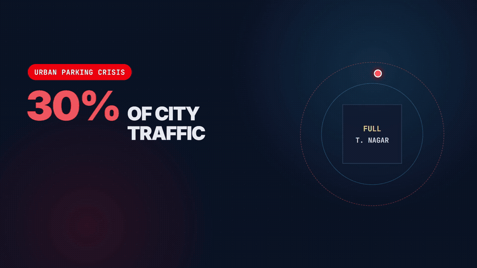
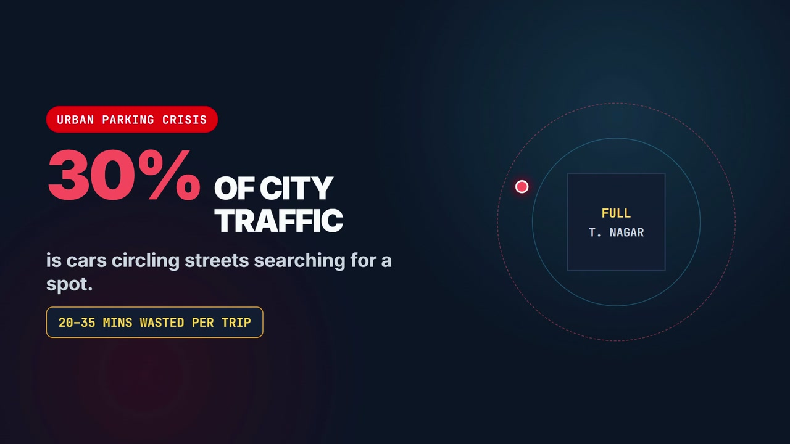
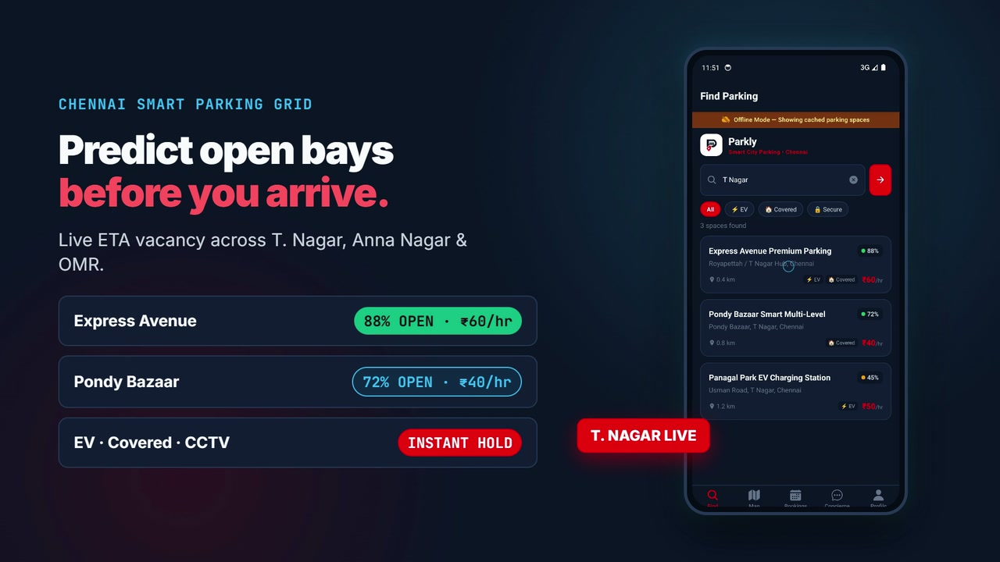
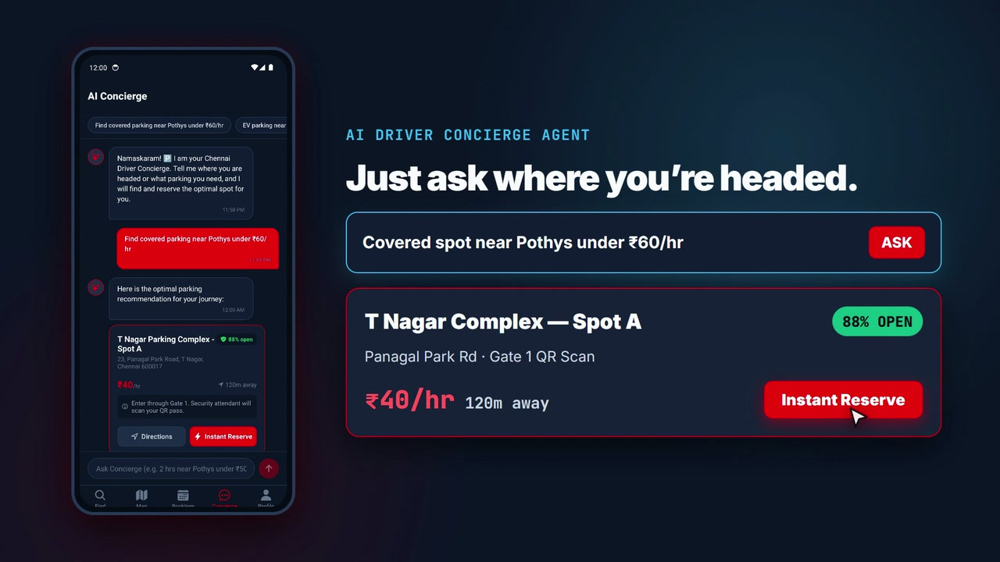
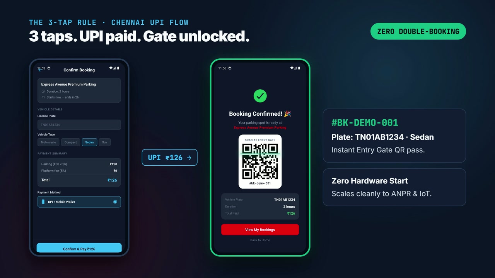
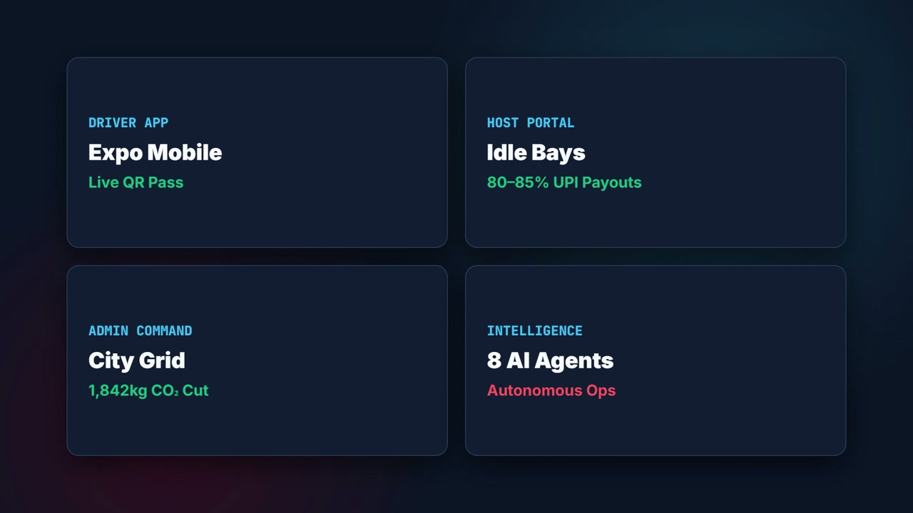
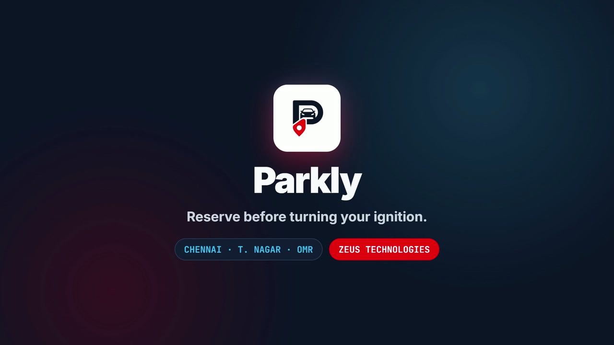

# 🎬 Parkly — Animated Demo Showcase & Feature Walkthrough

> **"Find, reserve, and navigate to your parking spot before you even turn on your ignition."**  
> Built by **ZEUS Technologies** · Launch Market: **Chennai, Tamil Nadu, India 🇮🇳**

<p align="center">
  
</p>

> **Watch the full loop (20 seconds):** From Chennai's **30% circling-traffic crisis** → **T. Nagar ETA prediction** → **AI Driver Concierge** → **3-Tap UPI Checkout (`TN01AB1234`)** → **Scannable Entry Gate QR Pass (`#BK-DEMO-001`)** → **Full 8-Agent Smart City Grid**.

---

## 🎯 What You See in Every Beat

The showcase above is assembled directly from **real Android 14 Emulator captures** ([see the full screenshot walkthrough](./09_MOBILE_APP_DEMO_WALKTHROUGH.md)) and grounded architectural telemetry from this repository.

| Window | Scene | Live Product Capability | Grounded Source |
| :--- | :--- | :--- | :--- |
| **`0.0s – 3.4s`** | **01. Urban Parking Crisis** | Frames the real mobility tax: drivers lose **20–35 mins/trip**, driving **30% of downtown congestion** circling for spots. | [01. Purpose & Ideology](./01_PROJECT_PURPOSE_AND_IDEOLOGY.md) |
| **`3.4s – 7.6s`** | **02. ETA Vacancy Discovery** | Displays real **T. Nagar** live cards (`Express Avenue · 88% open · ₹60/hr`, `Pondy Bazaar · 72% · ₹40/hr`) with EV/Covered/CCTV verification. | [Home Screen](../apps/mobile/app/(tabs)/home.tsx) |
| **`7.6s – 11.8s`** | **03. AI Driver Concierge** | Driver asks `"Covered spot near Pothys under ₹60/hr"` → AI Agent recommends **T Nagar Complex — Spot A** (`₹40/hr · 120m away`) with one-tap **`Instant Reserve`**. | [AI Concierge](../apps/mobile/app/(tabs)/concierge.tsx) |
| **`11.8s – 15.6s`** | **04. 3-Tap UPI → Gate QR Pass** | Pre-validated Tamil Nadu plate (`TN01AB1234`), UPI payment (`₹126`), atomic **ACID zero double-booking** lock, and instant **Gate QR Pass (`#BK-DEMO-001`)**. | [Booking Checkout](../apps/mobile/app/booking/create.tsx) |
| **`15.6s – 20.0s`** | **05. Ecosystem & Closer** | Highlights the 4-pillar platform: Driver Mobile, Host Dashboard (`80–85%` automated payouts), Admin Grid (`1,842 kg CO₂ Cut`), and **8 AI Agents**. | [Admin Overview](../apps/admin-portal/src/pages/Overview.tsx) |

---

## 🖼️ Storyboard Frame Reference

### 1. Hook — Urban Mobility Problem (`0.0s – 3.4s`)


Traditional parking runs on blind hope. Parkly's mission ([01_PROJECT_PURPOSE_AND_IDEOLOGY.md](./01_PROJECT_PURPOSE_AND_IDEOLOGY.md)) replaces random street cruising with deterministic software inventory before the driver starts the engine.

---

### 2. Chennai Discovery & ETA Prediction (`3.4s – 7.6s`)


Instead of static "maybe open right now" pins, Parkly scores arrival probability (**`88% OPEN`**, **`72% OPEN`**) so bays stay available at your ETA. Captured live from [`apps/mobile/app/(tabs)/home.tsx`](../apps/mobile/app/(tabs)/home.tsx).

---

### 3. Conversational AI Concierge (`7.6s – 11.8s`)


Powered by `DriverConciergeAgent` ([08_AI_AGENT_ARCHITECTURE.md](./08_AI_AGENT_ARCHITECTURE.md)) and wired cleanly in [`apps/mobile/app/(tabs)/concierge.tsx`](../apps/mobile/app/(tabs)/concierge.tsx), natural language queries resolve straight into priced, distance-ranked spots with entry gate notes and deep-link navigation.

---

### 4. The 3-Tap Rule: UPI Checkout → Entry Gate QR Pass (`11.8s – 15.6s`)


No physical barrier hardware required on Day 1. Drivers confirm plate (`TN01AB1234`), pay via UPI (`₹126`), and immediately unlock boom gates via high-contrast digital QR (`#BK-DEMO-001`) backed by PostgreSQL `FOR UPDATE` transactional locking ([booking/create.tsx](../apps/mobile/app/booking/create.tsx)).

---

### 5. Full-Stack Platform & Autonomous Agents (`15.6s – 20.0s`)
| Ecosystem Pillars | Official Brand Closer |
| :---: | :---: |
|  |  |

Behind the Driver App run:
- **Host Portal** ([`apps/host-dashboard`](../apps/host-dashboard)): Real-time occupancy charts, surge management, and automated **80–85% UPI payouts**.
- **Admin Command Portal** ([`apps/admin-portal`](../apps/admin-portal)): City-wide telemetry tracking **₹1,18,320** settlements and **1,842 kg CO₂** abated across urban hubs.
- **8 Autonomous AI Agents** ([`packages/ai-agents`](../packages/ai-agents)): `ParklyOrchestratorAgent`, `HostOnboardingAgent`, `VisualInspectionAgent`, `OccupancyPredictorAgent`, `DynamicPricingAgent`, `DriverConciergeAgent`, `DisputeMediationAgent`, and `CityAnalyticsAgent`.

---

## 📦 Media Assets & Local Customization

| Asset | Format & Specs | Intended Use |
| :--- | :--- | :--- |
| [**`parkly-demo.gif`**](./assets/parkly-demo.gif) | `960×540` · `12fps` · Two-pass Bayer palette (`< 9 MB`) | GitHub `README.md`, Pull Requests, Markdown Docs, Notion |
| **`brag-output/parkly-demo-hd.gif`** | `1280×720` · `18fps` · Sierra2_4a (`~23 MB`) | Offline investor slide decks, Keynote / PowerPoint |
| **`brag-output/brag.mp4`** | `1920×1080` · `30fps` · H.264 + AAC Audio (Music + UI SFX + Frame-0 Poster) | LinkedIn, X/Twitter, Product Hunt, Launch Reels |
| [**`parkly-hero-poster.jpg`**](./assets/parkly-hero-poster.jpg) | `1920×1080` JPEG | `<video poster="...">` thumbnail / Social OG card |

### Edit or Re-render Visually with Hyperframes

```bash
# Open interactive timeline editor & live hot-reload preview
cd brag-output/composition
npx hyperframes preview

# Run full lint, contrast, layout, motion, and audio verification
npx hyperframes check --strict

# Re-render full 1080p launch video (MP4 + audio)
npx hyperframes render --quality delivery --output ../brag.mp4
```
