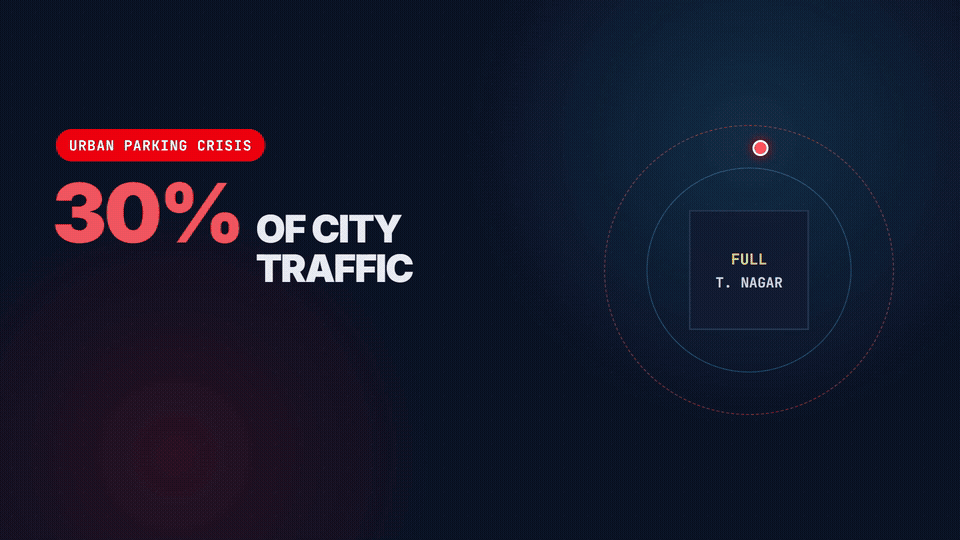

# 🅿️ PARKLY — MASTER PROJECT DOCUMENTATION & BLUEPRINT

> **The Decentralized Smart City Parking Marketplace**  
> *"Unlock Invisible Urban Parking — Find, Reserve, and Monetize in Real-Time."*  
> **Author**: ZEUS Technologies  
> **Launch Market**: Chennai, Tamil Nadu, India 🇮🇳 (Scaling to Pan-India & Global Smart Cities)  
> **Document Status**: Production Architecture & Onboarding Blueprint

<p align="center">
  
</p>

---

## 📑 Master Documentation Table of Contents

This master document serves as the Single Source of Truth (SSoT) for the Parkly platform, synthesizing business strategy, startup validation, architecture, and developer workflows across [`./docs`](./):

1. [**Project Purpose, Vision & Ideology**](./01_PROJECT_PURPOSE_AND_IDEOLOGY.md) — The urban parking crisis, mission statement, core philosophy, and 3-horizon growth vision.
2. [**USP, Business Model & Startup Validation**](./02_USP_AND_STARTUP_VALIDATION.md) — Unique selling propositions, competitive moats, TAM/SAM/SOM market sizing, customer personas, unit economics, and Chennai pilot GTM strategy.
3. [**System Architecture & Infrastructure Design**](./03_SYSTEM_ARCHITECTURE.md) — Cloud-native architecture topology, AWS infrastructure, EventBridge event choreography, security baselines, and SRE observability.
4. [**Technology Stack & Tooling Specifications**](./04_TECH_STACK_AND_TOOLS.md) — Expo SDK 54 / RN 0.79.1 / React 19.0.0 mobile app, React 18/Vite portals, Node.js/TypeScript services, PostgreSQL (Prisma), DynamoDB, AWS CDK, and Vitest.
5. [**Database Schemas, Data Models & State Machines**](./05_DATABASE_SCHEMA_AND_MODELS.md) — Complete ERD diagrams, relational models, enums, DynamoDB schemas, and booking concurrency locking state machines.
6. [**Core Services & Detailed API Specifications**](./06_CORE_SERVICES_AND_API_SPEC.md) — Standardized REST request/response contracts for Auth, Search, Booking, Payments, Host, Occupancy, Pricing, and Admin services.
7. [**Software Development Plan & Roadmap**](./07_SOFTWARE_DEVELOPMENT_PLAN_AND_ROADMAP.md) — 4-phase strategic roadmap, Sprint 0–7 execution milestones, and engineering quality standards.
8. [**Autonomous Multi-Agent Architecture**](./08_AI_AGENT_ARCHITECTURE.md) — Specifications for the 8 specialized autonomous agents automating onboarding, visual audit, predictive vacancy, dynamic pricing, concierge, and dispute mediation.
9. [**Mobile App Demo & UI Walkthrough**](./09_MOBILE_APP_DEMO_WALKTHROUGH.md) — Sequential Android 14 Emulator gallery covering Login, OTP, T. Nagar Discovery, Map, AI Concierge, Checkout, and Entry Gate QR Pass.
10. [**Animated Demo GIF & Launch Showcase**](./10_DEMO_GIF_AND_LAUNCH_SHOWCASE.md) — Embedded looping launch showcase ([`parkly-demo.gif`](./assets/parkly-demo.gif)), storyboard stills, and Hyperframes render pipeline.
11. [**Local Development & Testing Guide**](./11_TESTING_AND_LOCAL_DEV.md) — Docker setup, database seeding, gateway port map (`4000–4011`), and the 360-test verification pyramid.

---

## 1. Executive Summary & Core Purpose

In rapid-growth metropolitan cities across India and the globe, vehicle ownership has drastically outstripped urban parking infrastructure.

```
┌────────────────────────────────────────────────────────────────────────┐
│                        THE TRIPLE URBAN CRISIS                         │
├───────────────────────────────────┬────────────────────────────────────┤
│ 🚗 Drivers Waste 20–35 Mins/Trip  │ 30% of traffic congestion is pure  │
│    circling streets looking for a │ cruising for parking; lost fuel,   │
│    spot with zero certainty.      │ high stress, zero digital receipts.│
├───────────────────────────────────┼────────────────────────────────────┤
│ 🏡 Millions of Idle Driveways     │ Private driveways, society bays,   │
│    sit empty 60% to 80% of the    │ and corporate lots sit locked and  │
│    day producing zero revenue.    │ unmonetized with no trusted tool.  │
├───────────────────────────────────┼────────────────────────────────────┤
│ 🏙️ Cities Choke on Congestion     │ Unregulated roadside parking blocks│
│    with no real-time visibility   │ emergency corridors and costs      │
│    into actual parking demand.    │ billions in lost productivity.     │
└───────────────────────────────────┴────────────────────────────────────┘
```

**Parkly solves this crisis by creating an intelligent, high-liquidity two-sided marketplace ("Airbnb for Parking").**

Property owners (homeowners, commercial complexes, gated societies, malls) can list unused parking bays in minutes. Drivers discover bays, check predicted arrival probability at their ETA, reserve in 3 taps with UPI, and enter frictionlessly using a digital Entry Gate QR pass.

---

## 2. Unique Selling Proposition (USP) & Competitive Moat

1. **AI Predictive Vacancy at Arrival (ETA)**: Forecasts slot availability at the driver's projected arrival time with confidence scores rather than brittle live-only snapshots.
2. **Decentralized Crowdsourced Supply (Commercial + Private Homes)**: Zero real-estate CapEx; supports commercial lots (`commercial`) alongside private house driveways (`private_house`), apartment visitor bays (`apartment_bay`), and gated compounds (`gated_compound`) with custom arrival/gate instructions.
3. **Dual Driver & Host KYC + Review Team Gate**: Drivers verify with **Driving Licence, Vehicle Reg. No., RC Book, and Govt ID**; hosts verify with **Owner ID, Property Ownership Proof, and Parking Plot Pictures**. Submissions queue in `admin-service` / `Admin Portal` before listings become publicly bookable.
4. **Host–Driver Gate Handshake & Timing Protocol**: Every reservation pairs an offline HMAC **QR Pass** with a backup **4-digit Gate PIN** (`gateCode`) for residential driveways, enforcing a **15-minute early check-in window**, live countdowns, **15m-prior reminders**, **`Leaving Soon`** host alerts, capacity-checked extensions, and a **10-minute exit grace period** before automated prorated overstay settlement.
5. **Atomic Concurrency (Zero Double-Booking Guarantee)**: Strict PostgreSQL row-level transactional locking guarantees exclusive bay holds.
6. **Zero-Hardware to IoT-Ready Hybrid Onboarding**: Launches today with contactless Gate QR/PIN passes and software geofences; seamlessly integrates ultrasonic sensors and ANPR boom gates as sites scale.
7. **UPI-Native Checkout & Automated Host Payouts**: Instant UPI intent checkout and automated 80–85% split payouts for property hosts.
8. **Verified Trust & Autonomous Operations**: 8 specialized TypeScript AI agents (`@parkly/ai-agents`) automate host KYC verification, gate clearance photo audits, demand surge pricing, conversational routing, overstay dispute adjudication, and city CO₂ abatement reporting.

---

## 3. Startup Validation & Unit Economics

- **TAM**: Global Smart Parking market exceeding **$16.8B USD by 2030** (~13.4% CAGR).
- **SAM**: Top 8 Indian metros (`100M+` registered vehicles, `₹1.5 Lakh Crore` annual urban congestion economic loss).
- **SOM**: Chennai Phase-1 pilot across **T. Nagar, OMR IT Corridor, Anna Nagar, and Guindy**.
- **3-Hour Booking Unit Economics Example**:
  - Driver pays: ₹130 (₹120 parking base + ₹10 convenience fee).
  - Host receives: ₹96 (80% split payout).
  - Net Platform Revenue: ₹34 (~26.1% blended take rate; ~₹32 contribution margin net of UPI/SMS costs).

---

## 4. System Architecture & Technology Summary

```
┌──────────────────────────────────────────────────────────────────────────────┐
│                              CLIENT APPLICATIONS                             │
│   📱 Driver Mobile (Expo 54)   🖥️ Host Dashboard (Vite)   🔧 Admin (Vite)    │
└──────────────────────────────────────┬───────────────────────────────────────┘
                                       │ HTTPS / REST
                  ┌────────────────────▼────────────────────┐
                  │       API Gateway (:4000) + WAF         │
                  │  Rate Limiting · JWT Guard · CORS       │
                  └──┬───┬───┬───┬───┬───┬───┬───┬───┬───┬──┘
                     │   │   │   │   │   │   │   │   │   │
                     ▼   ▼   ▼   ▼   ▼   ▼   ▼   ▼   ▼   ▼
                 Auth Book Pay Srch Pred Occ Prc Ntf Host Admin
                 4001 4002 4003 4004 4005 4007 4008 4009 4010 4011
                     │                               │
                     ▼                               ▼
             PostgreSQL 16 (Prisma)          DynamoDB (OTP/Occupancy/Notifs)
                                 │
                                 ▼
                  EventBridge Async Bus ──► 8 Autonomous AI Agents
```

* **Mobile App**: React Native `0.79.1`, Expo SDK `54`, React `19.0.0`, Expo Router v6, Zustand, MapLibre / OpenFreeMap fallback.
* **Web Portals**: React 18 + Vite (`apps/host-dashboard` on `:3001`, `apps/admin-portal` on `:3002`), Recharts, Zustand.
* **Backend**: 11 Express/TypeScript microservices + shared `@parkly/shared` library + `packages/ai-agents` (`BaseAgent`, Zod schemas, `CircuitBreaker`, `SagaOrchestrator`, `InMemoryEventBus`).
* **Data & Cloud**: PostgreSQL 16 (`infra/prisma/`), DynamoDB, S3, and AWS CDK (`infra/cdk/`).

---

## 5. Current Implementation Status

The monorepo is scaffolded and runnable end-to-end across all three client surfaces, 11 microservices, 8 autonomous agents, PostgreSQL migrations (including private spaces, Driver/Host KYC, and gate check-in/overstay columns), Docker Compose local infra, and AWS CDK deployment stacks:
- **`packages/ai-agents`**: **24 test files / 360 tests passing** offline via `npm test -w packages/ai-agents`.
- **Service & App Jest Suites**: Unit & integration suites across `auth-service`, `booking-service`, `host-service`, `admin-service`, and `apps/mobile` (`9 suites / 33 tests` passing), alongside Vite builds for `host-dashboard` and `admin-portal`.
- **Developer Onboarding & Deployment**: See [11. Local Development & Testing](./11_TESTING_AND_LOCAL_DEV.md) and [Production Credentials & Deployment Guide](./PRODUCTION_CREDENTIALS_AND_DEPLOYMENT_GUIDE.md).
