# 08 — Prioritized Implementation Plan & Migration Roadmap (Stage C)

> **Repository Baseline**: `e:\Github\Parkly` (`main` @ commit `738e176`)  
> **Execution Governance**: Staged delivery (`Stage A` → `Stage G`). Every stage closes with: (1) full test/build verification, (2) `git diff` review, (3) `docs/engineering/*` updates, and (4) explicit completion/blocker sign-off before advancing.

---

## 1. Documentation & Stage Alignment Matrix

| Stage | Focus | Engineering Docs Delivered / Updated |
| :---: | :--- | :--- |
| **A** | Repository Revalidation *(No source changes)* | [`00_REVALIDATION_REPORT.md`](./00_REVALIDATION_REPORT.md) ✅ |
| **B** | Architecture Decisions & 11-Service Audit | [`01_ARCHITECTURE_DECISIONS.md`](./01_ARCHITECTURE_DECISIONS.md) ✅ |
| **C** | Prioritized Issue-by-Issue Implementation Plan | `08_MIGRATION_ROADMAP.md` *(this document)* ✅ |
| **D** | P0 Live Functionality Restoration (`Phase 1`) | `02_API_CONTRACTS.md`, `04_BOOKING_STATE_MACHINE.md` *(initial)* |
| **E** | Booking Concurrency, Payment Safety & Transactional Outbox (`Phase 2–3`) | `03_DATABASE_DESIGN.md`, `04_BOOKING_STATE_MACHINE.md`, `05_PAYMENT_DESIGN.md` |
| **F** | Modular Monolith Migration (`services/parkly-core-api/`) + QR/CI | `02_API_CONTRACTS.md` *(updated)*, `07_TEST_STRATEGY.md`, `09_DEPLOYMENT_RUNBOOK.md` |
| **G** | Search Spatial Accuracy (PostGIS), Security Hardening & Observability (`Phase 4–5`) | `06_SECURITY_REVIEW.md`, `10_KNOWN_LIMITATIONS.md`, benchmark reports |

---

## 2. Stage D — P0 Live Functionality Restoration (Approved Sequence: `ENG-D01`–`ENG-D07`)

**Goal**: Make live OTP Login → Search → Space Detail → Booking Reserve → UPI Payment Confirm → Gate Check-In/Out → Host/Admin Management execute cleanly end-to-end against PostgreSQL and DynamoDB without silent mock fallbacks, preserving existing service structure until P0s are stable.

| Issue ID | Status | Bugs Addressed | Title & Scope | Affected Workspaces | Dependencies | Acceptance Criteria & Verification |
| :--- | :---: | :--- | :--- | :--- | :--- | :--- |
| **`ENG-D01`** | **DONE** | `BUG-07`, `BUG-08` (config), `BUG-12`, `BUG-13` (health/logger), `BUG-15` | **Shared Core and Test Stability** — Remove 40 stale compiled `.js`/`.d.ts`/`.map` files in `shared/src/`; declare `@opentelemetry/api` in `shared/package.json`; make `jwtAccessSecret`/`jwtRefreshSecret` lazy in `getConfig()` + export `getJwtConfig()`; clear 3s `createHealthCheck` race timers in `finally`; disable `pino-pretty` when `NODE_ENV=test` and read `SERVICE_NAME` dynamically; normalize `requestLogger` `originalUrl` path; fix all 47 strict TS errors in `packages/ai-agents`; remove `timer.unref()` race in `BaseAgent`; remove recursive `"parkly": "file:../.."` mobile dependency & NTFS junction. | `shared/`, `packages/ai-agents/`, `apps/mobile/`, `package-lock.json` | None | `npm run build` exits `0`; `npm run typecheck` exits `0`; `npm test` passes cleanly (`434` tests across `shared`, services, and `ai-agents` `360/360`); Jest `--detectOpenHandles` reports zero leaks; `apps/mobile` `tsc --noEmit` & `expo export --platform android` pass. |
| **`ENG-D02`** | **DONE** | `BUG-01` (seeds), `BUG-04`, `BUG-05`, `NEW-02`, `NEW-08` | **Database and Seed Consistency** — Preserve `20260625230621_public` verbatim & remove loose `0001_init.sql`; add forward migration (`20261126140000_eng_d02_reconcile_integrity`) reconciling DPDPA columns + `deleted_at` indexes + pre-FK orphan guard + `Booking.hostId`, `ParkingSpace.regionId`, `Payment.payoutId` FKs; keep `'chennai-tn-in'` region, deterministic RFC4122 dev seed UUIDs (`seed-fixtures.ts` / `seed.ts` + fail-closed guard), and separate `seed-regions.ts`; fix `host-service` `resolveRegionForListing()`; create opt-in `reconcile_legacy_dev_data.sql`; fix workspace build order, `package-lock.json`, `.dockerignore`, Compose networking/healthchecks/`x-dev-runtime-env`, OpenSSL 3 + `USER node` + IPv4 web Dockerfiles, `local-seed.*`, `auth-service` scripts, & CI `parkly_shadow`. See [`ENG-D02_DATABASE_REPORT.md`](./ENG-D02_DATABASE_REPORT.md). | `infra/prisma/`, `services/host-service/`, `services/*/Dockerfile`, `apps/*/Dockerfile`, `apps/*/nginx.conf`, `services/auth-service/package.json`, `scripts/local-seed.*`, `docker-compose.yml`, `.env.example`, `.dockerignore`, `.github/workflows/ci.yml`, `.gitignore`, `package*.json` | `ENG-D01` | Disposable PG 16 passed `prisma validate`/`generate`/`diff --shadow-database-url`, `migrate deploy`, `status`, 2x seed (`28/1/4/2/1/3/1`), `SQLSTATE 23503`, & orphan abort; isolated Compose built `13/13` images with `15/15` healthy services (`t=6s`, `/ready -> 200`); `clean npm run build`, `typecheck`, `npm test` (**`443/443`** across `35` suites/files; `notification`/`occupancy`/`search` = `0` tests), and mobile `tsc` exited `0`; `parkly_postgres_data` untouched. |
| **`ENG-D03`** | **NEXT** | `BUG-02`, `NEW-01`, `NEW-04` | **Authentication and Authorization** — Unify public vs protected route classification across `api-gateway` & downstream services (`search`/`pricing` read-only public; `concierge` authenticated; fix `authenticate` before `requireRole('admin')` on `/occupancy/simulate`); hash OTPs (`SHA-256` + salt) & atomic attempts check; implement `/auth/profile` & device registration; fix fail-open `requireOwnership` & enforce strict ownership/RBAC on `host`, `payment`, `notification`, and `admin` endpoints with full 401/403 security tests. | `api-gateway`, `auth-service`, `host-service`, `payment-service`, `notification-service`, `occupancy-service`, `prediction-service`, `shared/` | `ENG-D02` | Every endpoint explicitly classified public/protected; tests verify unauthenticated (`401`), invalid/expired token (`401`), unauthorized role, cross-user/cross-host `403`, and admin-only operations. |
| **`ENG-D04`** | **PENDING** | `BUG-01`, `BUG-03`, `NEW-02`, `NEW-05` | **Booking Domain and API Contracts** — Add `/vehicles` lookup/create & real lookup checks; enforce UUID validation & consistent booking response envelopes; implement single server-controlled booking state machine (`held -> confirmed -> active -> completed` plus `expired`, `cancelled`, `no_show`, `overstay`) with preconditions & ownership guards; add check-in/checkout & `GET /host/bookings`; keep refunds and booking status synchronized (double-booking concurrency moves to Stage E). | `booking-service`, `payment-service`, `host-service`, `admin-service` | `ENG-D02`, `ENG-D03` | Valid transitions work, invalid transitions reject cleanly, ownership enforced on every action, and payment refunds sync booking status. |
| **`ENG-D05`** | **PENDING** | `BUG-01`, `BUG-02`, `BUG-09`, `NEW-07` | **Mobile Application Integration** — Restore Login → Search → Space → Vehicle → Book → Pay → Verify → Confirmed → Details → QR pass flow; remove hardcoded Tailscale IP `100.116.89.14`; fix booking response parsing, synthetic `veh-*` / `host-chennai-001` IDs, `paymentApi.confirm()`, future `arrivalTime`, `Number(hourlyRate)`, `[id].tsx` spinner, `km` vs `m`, `/notifications/devices`, local signed QR generation; enforce strict opt-in mock mode vs live mode. | `apps/mobile/` | `ENG-D03`, `ENG-D04` | Android emulator completes the live backend workflow with no synthetic fallback data in live mode. |
| **`ENG-D06`** | **PENDING** | `BUG-03`, `NEW-06`, `NEW-10` | **Web Portals Integration (`host-dashboard` & `admin-portal`)** — Unify each portal on one HTTP client; add `/login` + `ProtectedRoute`; fix `{ user, tokens }` auth parsing & token refresh; fix `BookingsAdmin` (`userId`), enums, `Unsuspend` handler, AI response schemas, `'draft'` badge; implement/align missing revenue/payouts/disputes/alerts/audit/user-management endpoints; remove fabricated `+ 412` / `|| 1` / catch-to-approved fallbacks. | `apps/host-dashboard/`, `apps/admin-portal/`, `host-service`, `admin-service` | `ENG-D03`, `ENG-D04` | Host and admin portals log in cleanly and display accurate live API loading/empty/error/data states. |
| **`ENG-D07`** | **PENDING** | `BUG-06`, `BUG-10`, `BUG-11`, `BUG-14`, `NEW-03` | **End-to-End Verification, CI Gates & Infra Build Fixes** — Resolve `cdk.context.json`/offline `cdk synth` (`NEW-03`); update CI `prisma migrate diff --shadow-database-url` & add `npm run typecheck`; align `ENG-D01`–`ENG-D06` integration tests; verify clean local/compose end-to-end health. *(Lint setup & core consolidation proceed in Stage F.)* | `infra/cdk/`, `.github/workflows/ci.yml`, integration tests | `ENG-D01`–`ENG-D06` | `npm run build`, `npm run typecheck`, `npm test`, and offline `cdk synth` pass cleanly; full driver/host/admin Stage D verification recorded. |

**Stage D Exit Gate & Backup Policy**: Verify live E2E driver/host/admin journeys pass against Docker Postgres + DynamoDB. Before running Stage E destructive/structural DB migrations, capture `pg_dump` snapshot and rollback SQL scripts.

---

## 3. Stage E — Booking Concurrency, Payment Safety & Transactional Outbox (Phases 2 & 3)

**Goal**: Guarantee zero double-bookings at database engine level, server-verified minor-unit payment integrity, and reliable asynchronous domain event delivery.

| Issue ID | Bugs Addressed | Title & Scope | Affected Workspaces | Dependencies | Acceptance Criteria & Verification |
| :--- | :--- | :--- | :--- | :--- | :--- |
| **`ENG-E01`** | `BUG-01` | **Physical Bay Inventory Model (`parking_bays`) & DB Exclusivity (`btree_gist`)** — Add `parking_bays` table (auto-provisioned bays `1..totalCapacity` per `ParkingSpace` with optional vehicle/EV capability tags); enable `btree_gist` extension; add `bay_id` + `effective_range` generated `tstzrange` column + `EXCLUDE USING gist (bay_id WITH =, effective_range WITH &&) WHERE (status IN ('held', 'confirmed', 'active'))`. Include explicit rollback migration dropping constraint & `bay_id` safely. | `infra/prisma/`, `services/booking-service`, `services/host-service` | `ENG-D04` | Migration creates bays for seeded lots cleanly; direct overlapping SQL insert against same `bay_id` fails with PostgreSQL `23P01` exclusion violation. |
| **`ENG-E02`** | `BUG-01` | **Transactional Bay Allocator, `Idempotency-Key` & Hold Expiration Worker** — Implement `idempotency_keys` table/middleware for mutating booking/payment endpoints; serialize allocation per space via parent `ParkingSpace` row lock (`FOR UPDATE`), select best free bay, insert `status = 'held'` (`holdExpiresAt = now + 7m`); run scheduled hold-expiration sweeper transitioning expired `held -> expired`. | `services/booking-service`, `shared/`, `infra/prisma/` | `ENG-E01` | **Mandatory Concurrency Acceptance Test**: `200` simultaneous overlapping requests for **1 bay** result in **exact 1 `201`** and **`199` controlled `409 Conflict`s** (`0` duplicate bookings/orphan payments). Multi-bay test proves a 5-bay lot accepts `5` overlapping reservations & rejects the 6th. |
| **`ENG-E03`** | `NEW-05` | **Payment Refactor: Integer Paise, 1:N Intents & Server Tariff Authority** — Convert internal monetary calculations to integer `BIGINT` minor units (`paise`), unify platform commission/fee rules in one authoritative calculator (removing conflicting 5%/15%/20% constants), migrate `Payment` from `1:1` to `1:N` (`payment_intents` supporting `initial`, `extension`, `overstay_penalty`, `refund`), recompute totals strictly server-side from booking duration + space rules. | `infra/prisma/`, `services/payment-service`, `services/booking-service` | `ENG-E01` | Property & unit tests verify exact paise rounding, zero float drift, multi-intent checkout/extension/overstay, and rejection of tampered client totals. |
| **`ENG-E04`** | `BUG-10`, `NEW-05` | **Webhook Cryptographic Enforcement, Reconciliation & Refund Synchronization** — Mandate timing-safe HMAC-SHA256 verification on `POST /payments/webhook` in all non-test modes (`NODE_ENV` test route explicitly tested via `supertest`); store processed webhook event IDs for idempotency; add background reconciliation poller for stale `pending` orders; synchronize cancellation/dispute refunds transactionally with `Booking.status = 'refunded'`; document India RBI PA/PG / split-settlement research findings in `05_PAYMENT_DESIGN.md` before live payouts. | `services/payment-service`, `services/booking-service`, `docs/engineering/05_PAYMENT_DESIGN.md` | `ENG-E03` | `supertest` proves unsigned/tampered webhooks return `400/401`; repeated webhook delivery is idempotent; refund updates both payment & booking state atomically. |
| **`ENG-E05`** | `BUG-08` | **Transactional Outbox (`outbox_events`) & Retryable Event Relay** — Create `outbox_events` table (`id`, `aggregate_type`, `aggregate_id`, `event_type`, `event_version`, `payload`, `attempts`, `next_retry_at`, `status`, `dead_lettered_at`); write events (`BookingCreated`, `BookingConfirmed`, `BookingCancelled`, `PaymentCaptured`, `PaymentRefunded`, `ParkingSpaceApproved`, `GateCheckIn`, `GateCheckOut`) inside the **exact Prisma transaction** of domain state changes; implement background relay worker with exponential backoff + DLQ marking & idempotent consumers. | `infra/prisma/`, `shared/`, `booking-service`, `payment-service`, `host-service`, `admin-service` | `ENG-D02`, `ENG-E02` | Integration test simulates EventBridge offline during booking & payment confirmation: API still returns `200/201`, row persists in `outbox_events`, and relay delivers when bus recovers without duplicates. |

**Stage E Exit Gate**: Zero double-booking under 200-request concurrency harness (`ENG-E02`), verified webhook/refund sync (`ENG-E04`), and verified Outbox resilience (`ENG-E05`). Docs `03`, `04`, `05` updated and committed.

---

## 4. Stage F — Modular Monolith Migration (`services/parkly-core-api/`) & Tooling Hardening

**Goal**: Incrementally migrate domain logic from fragmented services into `services/parkly-core-api/` behind compatibility proxy adapters while upgrading QR gate security, ESLint, containers, and CDK.

| Issue ID | Bugs Addressed | Title & Scope | Affected Workspaces | Dependencies | Acceptance Criteria & Verification |
| :--- | :--- | :--- | :--- | :--- | :--- |
| **`ENG-F01`** | `Decision A` | **Scaffold `services/parkly-core-api/` Strangler Foundation** — Bootstrap single Express/TypeScript core service on shared Postgres/Outbox runtime with unified DI container, Pino/OTel context, health probes, and module scaffolding (`auth`, `users`, `vehicles`, `parking-spaces`, `hosts`, `search`, `bookings`, `payments`, `gate-access`, `notifications`, `admin`, `compliance`). | `services/parkly-core-api/` *(new)*, `package.json` | `Stage E` | `npm run build -w services/parkly-core-api` and `/health` pass. |
| **`ENG-F02`** | `Decision A`, `NEW-09` | **Migrate Wave 1 Modules (`auth`, `users`, `vehicles`, `hosts`, `parking-spaces`)** — Port clean module layers (`routes`, `application`, `domain`, `repositories`, `schemas`, `__tests__`); repoint `api-gateway` `AUTH_URL`/`HOST_URL` compatibility routes to `parkly-core-api`; run side-by-side contract regression tests against Mobile & Host Dashboard before retiring old `auth-service`/`host-service` containers. | `services/parkly-core-api/`, `services/api-gateway/` | `ENG-F01` | Contract + integration suite passes identically whether gateway points to old services or `parkly-core-api`. |
| **`ENG-F03`** | `Decision A`, `NEW-09` | **Migrate Wave 2 Modules (`bookings`, `payments`, `gate-access`, `notifications`, `admin`, `compliance`, `search`)** — Port booking/bay allocator, payment/refund engine, check-in/out & offline QR signing (`gate-access`), notification dispatchers, admin/DPDP compliance, and search (consolidating duplicate concierge endpoints into one owner). Keep `prediction-service` interface optional/isolated if ML model diverges later. Decommission redundant Express packages only after E2E suite passes 100% through `parkly-core-api`. | `services/parkly-core-api/`, `services/api-gateway/`, deprecated `services/*` | `ENG-F02` | Full E2E test suite passes against `api-gateway` -> `parkly-core-api` (`+ prediction adapter`); redundant services safely archived/removed. |
| **`ENG-F04`** | `BUG-10`, `NEW-10` | **AI Adapter Interfaces, Notification Result Propagation & Saga Integrity** — Fix `RealNotificationProvider` to propagate delivery failure `Result` accurately; record `COMPENSATION_FAILED` inside `SagaOrchestrator`; wire clean provider registry into `parkly-core-api` tagging all mock/heuristic outputs transparently via `providerMode`. | `packages/ai-agents/`, `services/parkly-core-api/` | `ENG-D07`, `ENG-F03` | Vitest failure-injection tests pass; zero false positive `delivered: true` or masked saga failures. |
| **`ENG-F05`** | `BUG-09`, `NEW-07` | **Local Ed25519 Signed QR Gate Pass & Mobile Offline Verifier Prep** — Replace `api.qrserver.com` with native on-device QR SVG rendering (`react-native-qrcode-svg`); issue signed compact pass JWTs from `gate-access` module; implement offline signature check helper + host check-in UI hook (`confirmed -> active -> completed`). | `apps/mobile/`, `apps/host-dashboard/`, `services/parkly-core-api/` | `ENG-F03` | Unit tests prove forged/expired QR fails verification offline and authentic signed pass triggers check-in offline queue cleanly. |
| **`ENG-F06`** | `BUG-11`, `BUG-14` | **ESLint Config, Production Tsconfig Exclusions & Test Coverage Gates** — Install ESLint 9 + `@typescript-eslint` + React rules across workspace root; exclude `__tests__` from production `tsconfig.build.json`; remove `--passWithNoTests`; build unit/integration/E2E suites for previously untested services & UI portals. | Root, `packages/*`, `services/*`, `apps/*`, `.github/workflows/ci.yml` | `ENG-F03` | `npm run lint` passes with exit `0`; every workspace executes real tests with strict threshold enforcement. |
| **`ENG-F07`** | `BUG-05`, `BUG-06`, `NEW-03`, `NEW-08` | **Container & AWS CDK Alignment for Modular Core** — Replace `services/*/Dockerfile` boilerplate with clean hardened multi-stage image for `parkly-core-api` (+ `api-gateway` + portals); fix `ParklyStack` to deploy built container assets (removing `node:20-alpine` stub), add RDS SG ingress from ECS Fargate, prefix DynamoDB/EventBus names per `env`, consolidate `DatabaseStack`, and keep offline `cdk synth` green. | `docker-compose.yml`, `services/parkly-core-api/Dockerfile`, `infra/cdk/` | `ENG-F03` | `docker compose build && docker compose up` succeeds cleanly; `npm run cdk:synth` synthesizes complete real CloudFormation stacks in `dev` & `prod` offline. |

**Stage F Exit Gate**: Core backend operates via `parkly-core-api` + `api-gateway`; all E2E flows, lint, typecheck, Docker build, and CDK synth pass cleanly.

---

## 5. Stage G — Spatial Search Accuracy (PostGIS), Security Hardening & Production Readiness (Phases 4 & 5)

**Goal**: Establish accurate, fast PostGIS spatial search (benchmarking before any Redis/H3 complexity), finalize DPDP security documentation, wire real OpenTelemetry metrics/tracing, and pass full CI/CD quality gates.

| Issue ID | Bugs Addressed | Title & Scope | Affected Workspaces | Dependencies | Acceptance Criteria & Verification |
| :--- | :--- | :--- | :--- | :--- | :--- |
| **`ENG-G01`** | `Phase 4` | **PostGIS Spatial Extension, GiST Index & SQL Search Pushdown** — Enable PostGIS in Postgres 16; add `location GEOGRAPHY(Point, 4326)` column synced on write + GiST spatial index + GIN amenity indexes; rewrite `search` repository to run `ST_DWithin` + KNN `<->` distance sort + vehicle/amenity/availability filtering inside SQL (eliminating arbitrary `take: 500` in-memory truncation while preserving API response contract). | `infra/prisma/`, `services/parkly-core-api/src/modules/search/` | `Stage F` | Boundary spatial integration tests verify 100% recall inside radius with exact distance sort across >2,000 synthetic spaces (no truncation). |
| **`ENG-G02`** | `Phase 4` | **Search Latency Benchmarking & Redis/H3 Go-NoGo Evaluation** — Execute realistic load benchmark (`k6` / `autocannon` on 5,000–10,000 Chennai spaces) measuring P50/P95/P99 latency of PostGIS + prediction batch query; document results; introduce Redis/H3 spatial caching **only** if measured P95 exceeds `150ms`. | `docs/engineering/`, benchmark scripts | `ENG-G01` | Measured P95 `< 150ms` documented in `10_KNOWN_LIMITATIONS.md` / benchmark report (zero unmeasured performance claims). |
| **`ENG-G03`** | `Phase 5` | **Full Security Audit & Abuse Controls** — Review auth, token rotation/reuse detection, host BOLA, booking/payment ownership, upload MIME/size enforcement, webhook HMAC, QR key rotation, Secrets Manager usage, per-endpoint rate limits (OTP `5/min`, booking mutations), and structured audit logging table (`audit_logs` wired to Admin UI). | `services/parkly-core-api/`, `apps/admin-portal/`, `docs/engineering/06_SECURITY_REVIEW.md` | `ENG-F03` | Security regression suite validates auth, BOLA, rate limits, webhook spoofing rejection, and audit log emission. |
| **`ENG-G04`** | `Phase 5` | **DPDP-Aware Privacy Architecture & Legal Handoff Package** — Separate PII attributes or implement key-managed PII redaction + explicit consent tracking schema (`consent_records`), retention policy table, and anonymized GST ledger boundaries; deliver `06_SECURITY_REVIEW.md` explicitly listing items requiring formal legal counsel sign-off prior to launch. | `services/parkly-core-api/src/modules/compliance/`, `docs/engineering/06_SECURITY_REVIEW.md` | `ENG-G03` | Anonymization workflow preserves tax/booking integrity while redacting PII across Postgres + notification logs, flagged for legal audit. |
| **`ENG-G05`** | `BUG-13`, `Phase 5` | **Live OpenTelemetry Tracing, Metrics & Structured Logging** — Replace no-op tracing stub with real `@opentelemetry/sdk-node` + OTLP exporter (`OTEL_ENABLED` toggle), RED latency/error metrics, correlation IDs end-to-end (`Gateway -> Core -> Postgres -> Outbox`), and health/readiness probes across containers. | `shared/`, `services/parkly-core-api/`, `services/api-gateway/` | `ENG-F01` | Local OTel collector / test span exporter captures real HTTP -> Prisma child spans with propagated `traceparent`. |
| **`ENG-G06`** | `Testing & CI/CD` | **Full E2E Automated Pipeline & CI/CD Deployment Runbook** — Complete unit, PostgreSQL integration, and Playwright/API E2E tests covering full Driver, Host, and Admin workflows; lock `.github/workflows/ci.yml` gates (build, typecheck, lint, unit, Postgres integration, migration diff, CDK synth); complete `07_TEST_STRATEGY.md`, `09_DEPLOYMENT_RUNBOOK.md`, and `10_KNOWN_LIMITATIONS.md`. | `.github/workflows/ci.yml`, `docs/engineering/` | `ENG-G01`–`ENG-G05` | All CI checks pass cleanly on PR without skipped suites or `--passWithNoTests`. |

---

## 6. Critical Path & Next Step Checkpoint

```mermaid
flowchart LR
    D01["ENG-D01: Shared Core + Test Stability [DONE]"] --> D02["ENG-D02: Database, Seeds & Docker [DONE]"]
    D02 --> D03["ENG-D03: Auth & Authorization [NEXT]"]
    D03 --> D04["ENG-D04: Booking Domain & API Contracts"]
    D04 --> D05["ENG-D05: Mobile Integration"]
    D04 --> D06["ENG-D06: Web Portals Integration"]
    D05 & D06 --> D07["ENG-D07: CI & Infra Verification Gates"]
    D07 --> E01["ENG-E01..E02: physical_bays + btree_gist + 200-Req Concurrency"]
    E01 --> E03["ENG-E03..E05: Paise Ledger + HMAC Webhooks + Transactional Outbox"]
    E03 --> F["Stage F: Modular Core (parkly-core-api) + Signed QR + Lint/Docker/CDK"]
    F --> G["Stage G: PostGIS Search + Security + OTel + Final E2E Gates"]
```

> [!IMPORTANT]
> **Execution Checkpoint (`ENG-D02` Complete — Awaiting Review Before `ENG-D03`)**:
> `ENG-D02` schema, forward migration, deterministic RFC4122 seed fixtures + `seed-regions.ts`, `host-service` region resolution, workspace build order, `package-lock.json`, Docker Compose networking/healthchecks, `13/13` Dockerfiles (OpenSSL 3, `USER node`, IPv4 web probes), and CI `parkly_shadow` configuration are complete and verified via disposable PostgreSQL 16, isolated `parkly_d02_verify` Docker Compose (`15/15` healthy services), and the full regression suite (`443/443` tests passed). Pre-existing `parkly_postgres_data` was verified untouched. Ready for your review and authorization before starting **`ENG-D03` — Authentication and Authorization**.
