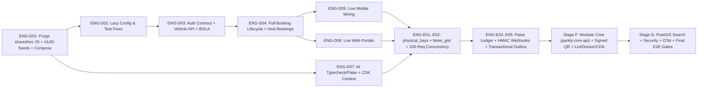

# 08 — Prioritized Implementation Plan & Migration Roadmap (Stage C)

> **Repository Baseline**: `e:\Github\Parkly` (`main` @ commit `738e176`)  
> **Execution Governance**: Staged delivery (`Stage A` → `Stage G`). Every stage closes with: (1) full test/build verification, (2) `git diff` review, (3) `docs/engineering/*` updates, and (4) explicit completion/blocker sign-off before advancing.

---

## 1. Documentation & Stage Alignment Matrix

| Stage | Focus | Engineering Docs Delivered / Updated |
| :---: | :--- | :--- |
| **A** | Repository Revalidation *(No source changes)* | [`00_REVALIDATION_REPORT.md`](./00_REVALIDATION_REPORT.md) ✅ |
| **B** | Architecture Decisions & 11-Service Audit | [`01_ARCHITECTURE_DECISIONS.md`](./01_ARCHITECTURE_DECISIONS.md) ✅ |
| **C** | Prioritized Issue-by-Issue Implementation Plan | `08_MIGRATION_ROADMAP.md` *(this document)* ✅ |
| **D** | P0 Live Functionality Restoration (`Phase 1`) | `02_API_CONTRACTS.md`, `04_BOOKING_STATE_MACHINE.md` *(initial)* |
| **E** | Booking Concurrency, Payment Safety & Transactional Outbox (`Phase 2–3`) | `03_DATABASE_DESIGN.md`, `04_BOOKING_STATE_MACHINE.md`, `05_PAYMENT_DESIGN.md` |
| **F** | Modular Monolith Migration (`services/parkly-core-api/`) + QR/CI | `02_API_CONTRACTS.md` *(updated)*, `07_TEST_STRATEGY.md`, `09_DEPLOYMENT_RUNBOOK.md` |
| **G** | Search Spatial Accuracy (PostGIS), Security Hardening & Observability (`Phase 4–5`) | `06_SECURITY_REVIEW.md`, `10_KNOWN_LIMITATIONS.md`, benchmark reports |

---

## 2. Stage D — P0 Live Functionality Restoration (Priority #1)

**Goal**: Make live OTP Login → Search → Space Detail → Booking Reserve → UPI Payment Confirm → Gate Check-In/Out → Host/Admin Management execute cleanly end-to-end against PostgreSQL and DynamoDB without silent mock fallbacks.

| Issue ID | Bugs Addressed | Title & Scope | Affected Workspaces | Dependencies | Acceptance Criteria & Verification |
| :--- | :--- | :--- | :--- | :--- | :--- |
| **`ENG-D01`** | `BUG-04`, `BUG-05`, `BUG-07`, `NEW-02`, `NEW-08` | **Foundation: Purge `shared/src/*.js`, Fix Prisma Migrations/Seed UUIDs & Compose Networking** — Remove tracked `.js`/`.d.ts`/`.map` files in `shared/src/`; add `dotenv`/lazy DB config safety; add missing `Booking.hostId` + `ParkingSpace.regionId` relations & DPDPA columns via clean reconciled migration (reconciling `0001_init.sql` vs `20260625230621_public`); convert `seed.ts` IDs to deterministic RFC4122 UUIDs; attach `postgres` & `dynamodb-*` to `parkly-net` and add `PREDICTION_URL`/`NOTIFICATION_URL` to `docker-compose.yml` + fix service Dockerfiles. | `shared/`, `infra/prisma/`, `docker-compose.yml`, `services/*/Dockerfile`, `.env.example` | None | `require('./shared/src/utils')` fails to shadow TS; `npx prisma migrate deploy` & `ts-node infra/prisma/seed.ts` succeed cleanly; `docker compose up` reaches green health across all containers; `prisma migrate diff --shadow-database-url` returns exit `0`. |
| **`ENG-D02`** | `BUG-08`, `BUG-13` | **Shared Config Lazy Validation & Test Stability** — Split `getConfig()` into lazy capability loaders (`getJwtConfig`, `getAwsConfig`, `getPaymentConfig`, etc.); guard `createHealthCheck` timeout handles with `clearTimeout`; disable `pino-pretty` when `NODE_ENV=test`; bind logger `SERVICE_NAME` cleanly & log `req.originalUrl`; declare `@opentelemetry/api` in `shared/package.json`. | `shared/src/` | `ENG-D01` | `npm test -w services/admin-service` passes with zero `JWT_ACCESS_SECRET` warnings; `booking-service` & `api-gateway` Jest exit cleanly without `--detectOpenHandles` leaks. |
| **`ENG-D03`** | `BUG-02`, `NEW-01`, `NEW-04` | **Unified Auth Contract, Salted OTP Hashing, Vehicle API & BOLA Guards** — Align gateway public vs protected routes with downstream routers (`search` & `pricing` read-only public; `concierge` authenticated; fix `authenticate` before `requireRole('admin')` on `/occupancy/simulate`); hash OTPs (`SHA-256` + salt) with atomic conditional `attempts` in DynamoDB; add `/vehicles` (`GET`, `POST`) and `GET/PATCH /auth/profile`; add `POST /notifications/devices` and restrict `POST /notifications/send` to admin/internal role; fix `requireOwnership` fail-closed + enforce `host.userId` & `payment.userId` checks. | `api-gateway`, `auth-service`, `search-service`, `pricing-service`, `prediction-service`, `occupancy-service`, `notification-service`, `host-service`, `payment-service`, `shared/` | `ENG-D02` | Supertest RBAC & BOLA tests verify `401` unauthenticated / `403` cross-user access on host/payment/notification endpoints; `/search` & `/pricing` respond without token; OTP hashed & locked after 5 attempts. |
| **`ENG-D04`** | `BUG-01`, `BUG-03`, `NEW-02`, `NEW-05` | **Complete Server-Enforced Booking Lifecycle & Host Bookings API** — Implement `held -> confirmed -> active -> completed` plus `expired`, `cancelled`, `no_show`, `overstay` server transitions; enforce allowed state map; expose authorized `POST /bookings/:id/checkin` (`confirmed -> active`) & `POST /bookings/:id/checkout` (`active/overstay -> completed`); expose `GET /host/bookings` scoped to verified host spaces; enforce valid enums. | `booking-service`, `host-service`, `admin-service` | `ENG-D01`, `ENG-D03` | Integration tests prove client cannot send arbitrary `status`; invalid transitions return `422`/`409`; host sees only reservations on own lots. |
| **`ENG-D05`** | `BUG-01`, `BUG-02`, `BUG-09` | **Mobile Live End-to-End Integration** — Replace default Tailscale IP `100.116.89.14` with env/emulator defaults (`10.0.2.2:4000` / `localhost:4000`); fix `apps/mobile/app/index.tsx` auth gating; wire real vehicle lookup/create in `booking/create.tsx`; parse `data.id`, call `paymentApi.confirm()` (dev mock/sandbox order confirm flow); add `try/finally { setLoading(false); }` in `booking/[id].tsx`; add future buffer to `arrivalTime` (`home.tsx`, `concierge.tsx`); parse `Number(hourlyRate)` & normalize security badges (`space/[id].tsx`); fix `concierge.tsx` unit (`km` vs `m`), `otp.tsx` resend error handling, `(auth)/_layout.tsx`, and `bookings.tsx` `useFocusEffect`; isolate demo mode strictly behind an explicit opt-in flag (`EXPO_PUBLIC_DEMO_MODE`). | `apps/mobile/` | `ENG-D03`, `ENG-D04` | Live Android Emulator walkthrough executes Login → Search → Space Detail → Book → Pay Confirm → Booking Detail Pass against running local gateway with zero silent fabricated fallback data. |
| **`ENG-D06`** | `BUG-03`, `NEW-02`, `NEW-06`, `NEW-10` | **Web Portals Auth, Routing, Schemas & Honest Data States** — Unify each portal onto one Axios client; add `/login` pages + `ProtectedRoute`; fix `authStore` payload parsing (`data.data.tokens.accessToken`); replace `b.driverId` with `userId` (`BookingsAdmin.tsx`); replace invalid `disputed`/`government` filters & broken `Unsuspend`; add or align missing backend routes (`GET /host/revenue`, `GET/POST /host/payouts`, `GET /admin/disputes`, `GET /admin/alerts`, `GET /admin/audit-logs`, `PUT /admin/users/:id/role|suspend`); fix AI field paths (`Verifications.tsx`, `CityAnalytics.tsx`, `Listings.tsx`) & status labels (`draft`); add modal/select/NotFound CSS; remove fabricated `+ 412` / `|| 1` / catch-to-approved fallbacks. | `apps/host-dashboard/`, `apps/admin-portal/`, `host-service`, `admin-service`, `auth-service` | `ENG-D03`, `ENG-D04` | Build + Playwright/RTL tests confirm host login, listing creation, booking table, admin approval, user filter, and analytics render cleanly against live backend. |
| **`ENG-D07`** | `BUG-12`, `BUG-15`, `BUG-14`, `NEW-03` | **Resolve AI-Agents Test Typecheck/Flake, Mobile Junction & Offline CI Checks** — Fix 47 TS errors in `packages/ai-agents/tsconfig.test.json`, replace `timer.unref()` with explicit `clearTimeout` in `BaseAgent` (`adversarial.spec.ts:247` flake); remove `"parkly": "file:../.."` from `apps/mobile/package.json` & lockfile; fix `auth-service/package.json` `migrate`/`seed` scripts; fix `cdk.context.json`/VPC synth & CI `prisma migrate diff --shadow-database-url` + add `npm run typecheck` to CI. | `packages/ai-agents/`, `apps/mobile/`, `services/auth-service/`, `infra/cdk/`, `.github/workflows/ci.yml` | `ENG-D01` | `npm test`, `npm run typecheck -w packages/ai-agents`, and `npm run cdk:synth -w infra/cdk` all pass cleanly with `0` flakes. |

**Stage D Exit Gate & Backup Policy**: Verify live E2E driver/host/admin journeys pass against Docker Postgres + DynamoDB. Before running Stage E destructive/structural DB migrations, capture `pg_dump` snapshot and rollback SQL scripts.

---

## 3. Stage E — Booking Concurrency, Payment Safety & Transactional Outbox (Phases 2 & 3)

**Goal**: Guarantee zero double-bookings at database engine level, server-verified minor-unit payment integrity, and reliable asynchronous domain event delivery.

| Issue ID | Bugs Addressed | Title & Scope | Affected Workspaces | Dependencies | Acceptance Criteria & Verification |
| :--- | :--- | :--- | :--- | :--- | :--- |
| **`ENG-E01`** | `BUG-01` | **Physical Bay Inventory Model (`parking_bays`) & DB Exclusivity (`btree_gist`)** — Add `parking_bays` table (auto-provisioned bays `1..totalCapacity` per `ParkingSpace` with optional vehicle/EV capability tags); enable `btree_gist` extension; add `bay_id` + `effective_range` generated `tstzrange` column + `EXCLUDE USING gist (bay_id WITH =, effective_range WITH &&) WHERE (status IN ('held', 'confirmed', 'active'))`. Include explicit rollback migration dropping constraint & `bay_id` safely. | `infra/prisma/`, `services/booking-service`, `services/host-service` | `ENG-D04` | Migration creates bays for seeded lots cleanly; direct overlapping SQL insert against same `bay_id` fails with PostgreSQL `23P01` exclusion violation. |
| **`ENG-E02`** | `BUG-01` | **Transactional Bay Allocator, `Idempotency-Key` & Hold Expiration Worker** — Implement `idempotency_keys` table/middleware for mutating booking/payment endpoints; serialize allocation per space via parent `ParkingSpace` row lock (`FOR UPDATE`), select best free bay, insert `status = 'held'` (`holdExpiresAt = now + 7m`); run scheduled hold-expiration sweeper transitioning expired `held -> expired`. | `services/booking-service`, `shared/`, `infra/prisma/` | `ENG-E01` | **Mandatory Concurrency Acceptance Test**: `200` simultaneous overlapping requests for **1 bay** result in **exact 1 `201`** and **`199` controlled `409 Conflict`s** (`0` duplicate bookings/orphan payments). Multi-bay test proves a 5-bay lot accepts `5` overlapping reservations & rejects the 6th. |
| **`ENG-E03`** | `NEW-05` | **Payment Refactor: Integer Paise, 1:N Intents & Server Tariff Authority** — Convert internal monetary calculations to integer `BIGINT` minor units (`paise`), unify platform commission/fee rules in one authoritative calculator (removing conflicting 5%/15%/20% constants), migrate `Payment` from `1:1` to `1:N` (`payment_intents` supporting `initial`, `extension`, `overstay_penalty`, `refund`), recompute totals strictly server-side from booking duration + space rules. | `infra/prisma/`, `services/payment-service`, `services/booking-service` | `ENG-E01` | Property & unit tests verify exact paise rounding, zero float drift, multi-intent checkout/extension/overstay, and rejection of tampered client totals. |
| **`ENG-E04`** | `BUG-10`, `NEW-05` | **Webhook Cryptographic Enforcement, Reconciliation & Refund Synchronization** — Mandate timing-safe HMAC-SHA256 verification on `POST /payments/webhook` in all non-test modes (`NODE_ENV` test route explicitly tested via `supertest`); store processed webhook event IDs for idempotency; add background reconciliation poller for stale `pending` orders; synchronize cancellation/dispute refunds transactionally with `Booking.status = 'refunded'`; document India RBI PA/PG / split-settlement research findings in `05_PAYMENT_DESIGN.md` before live payouts. | `services/payment-service`, `services/booking-service`, `docs/engineering/05_PAYMENT_DESIGN.md` | `ENG-E03` | `supertest` proves unsigned/tampered webhooks return `400/401`; repeated webhook delivery is idempotent; refund updates both payment & booking state atomically. |
| **`ENG-E05`** | `BUG-08` | **Transactional Outbox (`outbox_events`) & Retryable Event Relay** — Create `outbox_events` table (`id`, `aggregate_type`, `aggregate_id`, `event_type`, `event_version`, `payload`, `attempts`, `next_retry_at`, `status`, `dead_lettered_at`); write events (`BookingCreated`, `BookingConfirmed`, `BookingCancelled`, `PaymentCaptured`, `PaymentRefunded`, `ParkingSpaceApproved`, `GateCheckIn`, `GateCheckOut`) inside the **exact Prisma transaction** of domain state changes; implement background relay worker with exponential backoff + DLQ marking & idempotent consumers. | `infra/prisma/`, `shared/`, `booking-service`, `payment-service`, `host-service`, `admin-service` | `ENG-D02`, `ENG-E02` | Integration test simulates EventBridge offline during booking & payment confirmation: API still returns `200/201`, row persists in `outbox_events`, and relay delivers when bus recovers without duplicates. |

**Stage E Exit Gate**: Zero double-booking under 200-request concurrency harness (`ENG-E02`), verified webhook/refund sync (`ENG-E04`), and verified Outbox resilience (`ENG-E05`). Docs `03`, `04`, `05` updated and committed.

---

## 4. Stage F — Modular Monolith Migration (`services/parkly-core-api/`) & Tooling Hardening

**Goal**: Incrementally migrate domain logic from fragmented services into `services/parkly-core-api/` behind compatibility proxy adapters while upgrading QR gate security, ESLint, containers, and CDK.

| Issue ID | Bugs Addressed | Title & Scope | Affected Workspaces | Dependencies | Acceptance Criteria & Verification |
| :--- | :--- | :--- | :--- | :--- | :--- |
| **`ENG-F01`** | `Decision A` | **Scaffold `services/parkly-core-api/` Strangler Foundation** — Bootstrap single Express/TypeScript core service on shared Postgres/Outbox runtime with unified DI container, Pino/OTel context, health probes, and module scaffolding (`auth`, `users`, `vehicles`, `parking-spaces`, `hosts`, `search`, `bookings`, `payments`, `gate-access`, `notifications`, `admin`, `compliance`). | `services/parkly-core-api/` *(new)*, `package.json` | `Stage E` | `npm run build -w services/parkly-core-api` and `/health` pass. |
| **`ENG-F02`** | `Decision A`, `NEW-09` | **Migrate Wave 1 Modules (`auth`, `users`, `vehicles`, `hosts`, `parking-spaces`)** — Port clean module layers (`routes`, `application`, `domain`, `repositories`, `schemas`, `__tests__`); repoint `api-gateway` `AUTH_URL`/`HOST_URL` compatibility routes to `parkly-core-api`; run side-by-side contract regression tests against Mobile & Host Dashboard before retiring old `auth-service`/`host-service` containers. | `services/parkly-core-api/`, `services/api-gateway/` | `ENG-F01` | Contract + integration suite passes identically whether gateway points to old services or `parkly-core-api`. |
| **`ENG-F03`** | `Decision A`, `NEW-09` | **Migrate Wave 2 Modules (`bookings`, `payments`, `gate-access`, `notifications`, `admin`, `compliance`, `search`)** — Port booking/bay allocator, payment/refund engine, check-in/out & offline QR signing (`gate-access`), notification dispatchers, admin/DPDP compliance, and search (consolidating duplicate concierge endpoints into one owner). Keep `prediction-service` interface optional/isolated if ML model diverges later. Decommission redundant Express packages only after E2E suite passes 100% through `parkly-core-api`. | `services/parkly-core-api/`, `services/api-gateway/`, deprecated `services/*` | `ENG-F02` | Full E2E test suite passes against `api-gateway` -> `parkly-core-api` (`+ prediction adapter`); redundant services safely archived/removed. |
| **`ENG-F04`** | `BUG-10`, `NEW-10` | **AI Adapter Interfaces, Notification Result Propagation & Saga Integrity** — Fix `RealNotificationProvider` to propagate delivery failure `Result` accurately; record `COMPENSATION_FAILED` inside `SagaOrchestrator`; wire clean provider registry into `parkly-core-api` tagging all mock/heuristic outputs transparently via `providerMode`. | `packages/ai-agents/`, `services/parkly-core-api/` | `ENG-D07`, `ENG-F03` | Vitest failure-injection tests pass; zero false positive `delivered: true` or masked saga failures. |
| **`ENG-F05`** | `BUG-09`, `NEW-07` | **Local Ed25519 Signed QR Gate Pass & Mobile Offline Verifier Prep** — Replace `api.qrserver.com` with native on-device QR SVG rendering (`react-native-qrcode-svg`); issue signed compact pass JWTs from `gate-access` module; implement offline signature check helper + host check-in UI hook (`confirmed -> active -> completed`). | `apps/mobile/`, `apps/host-dashboard/`, `services/parkly-core-api/` | `ENG-F03` | Unit tests prove forged/expired QR fails verification offline and authentic signed pass triggers check-in offline queue cleanly. |
| **`ENG-F06`** | `BUG-11`, `BUG-14` | **ESLint Config, Production Tsconfig Exclusions & Test Coverage Gates** — Install ESLint 9 + `@typescript-eslint` + React rules across workspace root; exclude `__tests__` from production `tsconfig.build.json`; remove `--passWithNoTests`; build unit/integration/E2E suites for previously untested services & UI portals. | Root, `packages/*`, `services/*`, `apps/*`, `.github/workflows/ci.yml` | `ENG-F03` | `npm run lint` passes with exit `0`; every workspace executes real tests with strict threshold enforcement. |
| **`ENG-F07`** | `BUG-05`, `BUG-06`, `NEW-03`, `NEW-08` | **Container & AWS CDK Alignment for Modular Core** — Replace `services/*/Dockerfile` boilerplate with clean hardened multi-stage image for `parkly-core-api` (+ `api-gateway` + portals); fix `ParklyStack` to deploy built container assets (removing `node:20-alpine` stub), add RDS SG ingress from ECS Fargate, prefix DynamoDB/EventBus names per `env`, consolidate `DatabaseStack`, and keep offline `cdk synth` green. | `docker-compose.yml`, `services/parkly-core-api/Dockerfile`, `infra/cdk/` | `ENG-F03` | `docker compose build && docker compose up` succeeds cleanly; `npm run cdk:synth` synthesizes complete real CloudFormation stacks in `dev` & `prod` offline. |

**Stage F Exit Gate**: Core backend operates via `parkly-core-api` + `api-gateway`; all E2E flows, lint, typecheck, Docker build, and CDK synth pass cleanly.

---

## 5. Stage G — Spatial Search Accuracy (PostGIS), Security Hardening & Production Readiness (Phases 4 & 5)

**Goal**: Establish accurate, fast PostGIS spatial search (benchmarking before any Redis/H3 complexity), finalize DPDP security documentation, wire real OpenTelemetry metrics/tracing, and pass full CI/CD quality gates.

| Issue ID | Bugs Addressed | Title & Scope | Affected Workspaces | Dependencies | Acceptance Criteria & Verification |
| :--- | :--- | :--- | :--- | :--- | :--- |
| **`ENG-G01`** | `Phase 4` | **PostGIS Spatial Extension, GiST Index & SQL Search Pushdown** — Enable PostGIS in Postgres 16; add `location GEOGRAPHY(Point, 4326)` column synced on write + GiST spatial index + GIN amenity indexes; rewrite `search` repository to run `ST_DWithin` + KNN `<->` distance sort + vehicle/amenity/availability filtering inside SQL (eliminating arbitrary `take: 500` in-memory truncation while preserving API response contract). | `infra/prisma/`, `services/parkly-core-api/src/modules/search/` | `Stage F` | Boundary spatial integration tests verify 100% recall inside radius with exact distance sort across >2,000 synthetic spaces (no truncation). |
| **`ENG-G02`** | `Phase 4` | **Search Latency Benchmarking & Redis/H3 Go-NoGo Evaluation** — Execute realistic load benchmark (`k6` / `autocannon` on 5,000–10,000 Chennai spaces) measuring P50/P95/P99 latency of PostGIS + prediction batch query; document results; introduce Redis/H3 spatial caching **only** if measured P95 exceeds `150ms`. | `docs/engineering/`, benchmark scripts | `ENG-G01` | Measured P95 `< 150ms` documented in `10_KNOWN_LIMITATIONS.md` / benchmark report (zero unmeasured performance claims). |
| **`ENG-G03`** | `Phase 5` | **Full Security Audit & Abuse Controls** — Review auth, token rotation/reuse detection, host BOLA, booking/payment ownership, upload MIME/size enforcement, webhook HMAC, QR key rotation, Secrets Manager usage, per-endpoint rate limits (OTP `5/min`, booking mutations), and structured audit logging table (`audit_logs` wired to Admin UI). | `services/parkly-core-api/`, `apps/admin-portal/`, `docs/engineering/06_SECURITY_REVIEW.md` | `ENG-F03` | Security regression suite validates auth, BOLA, rate limits, webhook spoofing rejection, and audit log emission. |
| **`ENG-G04`** | `Phase 5` | **DPDP-Aware Privacy Architecture & Legal Handoff Package** — Separate PII attributes or implement key-managed PII redaction + explicit consent tracking schema (`consent_records`), retention policy table, and anonymized GST ledger boundaries; deliver `06_SECURITY_REVIEW.md` explicitly listing items requiring formal legal counsel sign-off prior to launch. | `services/parkly-core-api/src/modules/compliance/`, `docs/engineering/06_SECURITY_REVIEW.md` | `ENG-G03` | Anonymization workflow preserves tax/booking integrity while redacting PII across Postgres + notification logs, flagged for legal audit. |
| **`ENG-G05`** | `BUG-13`, `Phase 5` | **Live OpenTelemetry Tracing, Metrics & Structured Logging** — Replace no-op tracing stub with real `@opentelemetry/sdk-node` + OTLP exporter (`OTEL_ENABLED` toggle), RED latency/error metrics, correlation IDs end-to-end (`Gateway -> Core -> Postgres -> Outbox`), and health/readiness probes across containers. | `shared/`, `services/parkly-core-api/`, `services/api-gateway/` | `ENG-F01` | Local OTel collector / test span exporter captures real HTTP -> Prisma child spans with propagated `traceparent`. |
| **`ENG-G06`** | `Testing & CI/CD` | **Full E2E Automated Pipeline & CI/CD Deployment Runbook** — Complete unit, PostgreSQL integration, and Playwright/API E2E tests covering full Driver, Host, and Admin workflows; lock `.github/workflows/ci.yml` gates (build, typecheck, lint, unit, Postgres integration, migration diff, CDK synth); complete `07_TEST_STRATEGY.md`, `09_DEPLOYMENT_RUNBOOK.md`, and `10_KNOWN_LIMITATIONS.md`. | `.github/workflows/ci.yml`, `docs/engineering/` | `ENG-G01`–`ENG-G05` | All CI checks pass cleanly on PR without skipped suites or `--passWithNoTests`. |

---

## 6. Critical Path & Next Step Checkpoint

> [!IMPORTANT]
> **Execution Checkpoint (Awaiting Explicit Sign-Off)**:
> Stages A, B, and C deliverables ([`00_REVALIDATION_REPORT.md`](./00_REVALIDATION_REPORT.md), [`01_ARCHITECTURE_DECISIONS.md`](./01_ARCHITECTURE_DECISIONS.md), and `08_MIGRATION_ROADMAP.md`) are complete with zero application source files altered. Please confirm approval to begin **Stage D (`ENG-D01` through `ENG-D07`)** P0 fixes.
